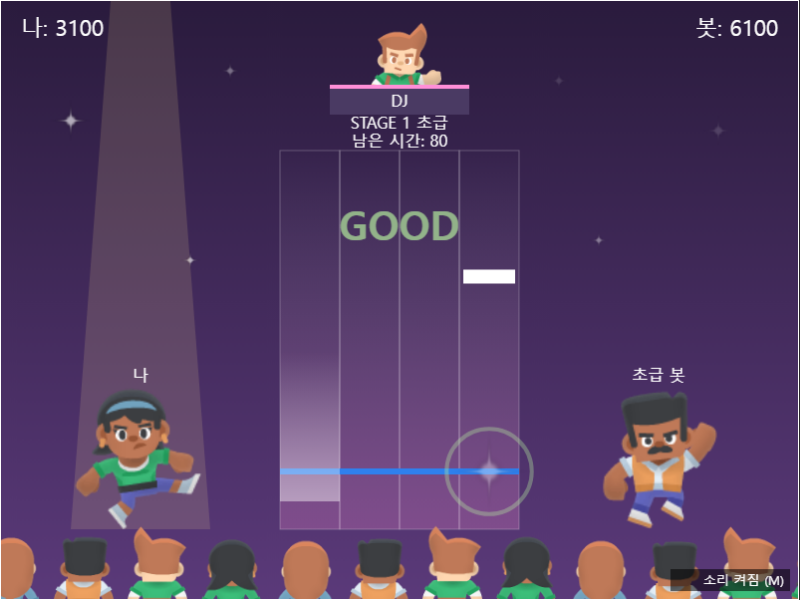

# 오늘 밤 주인공은 나야나

봇 댄서와 90초 동안 댄스 배틀을 하면서, 내려오는 노트를 음악 박자에 맞춰 쳐서 봇보다 높은 점수를 얻는 1인용 리듬게임

## 플레이하기
👉 https://soun0607.github.io/my_game/

- 학번 / 이름: 202370013 / 김소운 (프로그래밍 입문 수업 웹 게임)

## 조작법
| 키 | 동작 |
|---|---|
| 아무 키 | 시작 화면에서 게임 시작 |
| A S K L | 각 레인의 노트 치기 |
| Space | 레인 전체를 가로지르는 Space 노트 치기 |
| ESC | 일시정지 / 계속하기 |
| R | 언제든지 지금 스테이지를 처음부터 다시 시작 |
| Enter | 결과 화면에서 다음 스테이지 (지면 다시 도전) |
| M | 소리 끄기 / 켜기 |

- 시작 화면에서 화면을 클릭하면 메뉴 음악이 나온다 (브라우저는 클릭 전에는 소리를 막는다)
- 동시 노트가 내려오면 두 키를 같이 누른다
- 판정이 늦거나 빠르게 느껴지면 화면 아래 **싱크 조절** 막대로 맞춘다 (+면 조금 늦게 눌러도 정확하게 판정). 맞춘 값은 이 브라우저에 기억된다

## 규칙
- 목표: 90초 동안 봇보다 점수가 높으면 승리. 초급 → 중급 → 상급을 모두 이기면 최종 우승
- 점수: 노트가 판정선(파란 선)에 가까울 때 칠수록 높다. PERFECT 700점 / GREAT 500점 / GOOD 200점 / MISS 0점
- MISS: 너무 일찍·늦게 치거나 노트를 놓치면 MISS가 뜨고 레인이 빨갛게 번쩍인다
- 게임 오버: 90초가 끝났을 때 봇보다 점수가 낮으면 패배. Enter로 같은 스테이지를 다시 도전한다
- 스테이지가 올라갈수록 음악이 빨라지고(101 → 115 → 140 BPM) 노트가 촘촘해지며, 봇도 노트를 더 잘 친다

## 모바일
- 휴대폰에서도 화면은 잘리지 않고 보이도록 맞췄다 (canvas가 화면 크기에 맞춰 줄어든다)
- **터치 조작은 지원하지 않는다.** 4개 레인 + Space를 동시에 눌러야 하는 리듬게임이라 키보드가 필요하다. PC에서 플레이해 주세요 (시작 화면에도 안내가 나온다)

## 개발 환경
- 순수 HTML / CSS / JavaScript (Canvas)
- 외부 라이브러리 없음
- 에디터: VS Code
- 사용한 AI 도구: Claude Code (VS Code 확장)
- 배포: GitHub Pages

## 사용한 에셋
| 파일 | 용도 | 출처 | 라이선스 |
|---|---|---|---|
| assets/player.png, player_left/down/up/right/space.png | 내 캐릭터 (기본·춤 포즈) | Kenney "Toon Characters" (femalePerson cheer0·kick·duck·jump·cheer1·wide) https://kenney.nl/assets/toon-characters | CC0 |
| assets/bot.png, bot_left/down/up/right/space.png | 봇 캐릭터 (기본·춤 포즈) | Kenney "Toon Characters" (malePerson cheer1·kick·duck·jump·wide) https://kenney.nl/assets/toon-characters | CC0 |
| assets/dj.png | DJ | Kenney "Toon Characters" (maleAdventurer interact) https://kenney.nl/assets/toon-characters | CC0 |
| assets/crowd1~4.png | 관중 | Kenney "Toon Characters" (각 캐릭터 back) https://kenney.nl/assets/toon-characters | CC0 |
| assets/note_space.png | Space 노트 | Kenney "Input Prompts" (keyboard_space) https://kenney.nl/assets/input-prompts | CC0 |
| assets/sparkle.png | 반짝이 별, 적중 이펙트 | Kenney "Particle Pack" (star_06) https://kenney.nl/assets/particle-pack | CC0 |
| (코드) | A S K L 노트와 과녁, 무대·레인·판정선 | 직접 제작 (Canvas로 그림) | - |
| assets/sounds/bgm_menu.mp3 | 시작 화면 음악 | "Disco Lounge" — Kevin MacLeod (incompetech.com), 109 BPM https://incompetech.com/music/royalty-free/index.html?isrc=USUAN1100602 | CC BY 4.0 |
| assets/sounds/bgm_stage1.mp3 | 초급 음악 | "Funkorama" — Kevin MacLeod (incompetech.com), 101 BPM https://incompetech.com/music/royalty-free/index.html?isrc=USUAN1100474 | CC BY 4.0 |
| assets/sounds/bgm_stage2.mp3 | 중급 음악 | "Disco con Tutti" — Kevin MacLeod (incompetech.com), 115 BPM https://incompetech.com/music/royalty-free/index.html?isrc=USUAN1200091 | CC BY 4.0 |
| assets/sounds/bgm_stage3.mp3 | 상급 음악 | "Future Cha Cha" — Kevin MacLeod (incompetech.com), 140 BPM https://incompetech.com/music/royalty-free/index.html?isrc=USUAN1100374 | CC BY 4.0 |
| assets/sounds/se_hit.mp3 | 노트 적중음 (PERFECT·GREAT·GOOD 공통) | Mixkit "Game ball tap" https://mixkit.co/free-sound-effects/download/2073/ | Mixkit License |
| assets/sounds/se_start.mp3 | 게임 시작음 | Mixkit "Unlock game notification" https://mixkit.co/free-sound-effects/download/253/ | Mixkit License |
| assets/sounds/se_count.mp3 | 카운트다운 삑 | Mixkit "Positive interface beep" https://mixkit.co/free-sound-effects/download/221/ | Mixkit License |
| assets/sounds/se_clear.mp3 | 스테이지 승리 (관중 환호) | Mixkit "Huge crowd cheering victory" https://mixkit.co/free-sound-effects/download/462/ | Mixkit License |
| assets/sounds/se_lose.mp3 | 패배 효과음 | Mixkit "Losing piano" https://mixkit.co/free-sound-effects/download/2024/ | Mixkit License |

**배경음악 출처 표기 (CC BY 4.0)**
- "Disco Lounge", "Funkorama", "Disco con Tutti", "Future Cha Cha" — Kevin MacLeod (incompetech.com)
  Licensed under Creative Commons: By Attribution 4.0 License — http://creativecommons.org/licenses/by/4.0/
- 변경 사항: 웹에서 빨리 불러오도록 각 곡의 앞부분만 잘라서 사용했다 (메뉴 음악 약 60초, 스테이지 음악 약 100초).

**라이선스 메모**
- Kenney 에셋: CC0 (퍼블릭 도메인). 출처 표기 의무는 없지만 적어 둔다.
- Mixkit 효과음: Mixkit Sound Effects Free License (https://mixkit.co/license/#sfxFree). 무료, 출처 표기 의무 없음. 효과음 파일만 따로 재배포·판매하는 것은 금지.

## 제작 과정
10주 동안 매주 한 단계씩 쌓아 만들었습니다.
자세한 기록은 [회고.md](회고.md), [기획서.md](기획서.md), [디버깅기록.md](디버깅기록.md), [플레이테스트.md](플레이테스트.md), [테스트목록.md](테스트목록.md)를 참고하세요.

- [x] 1주차: 자기소개 페이지, 게임 아이디어 3가지 중 "오늘 밤 주인공은 나야나" 선택 (평소에 리듬게임을 좋아해서)
- [x] 2주차: GitHub 배포
- [x] 3주차: 게임 화면 그리기
- [x] 4주차: 게임 루프 (노트 떨어지기)
- [x] 5주차: 키 입력과 노트 판정
- [x] 6주차: 점수, 제한 시간, 승패 (플레이 가능한 최소 버전)
- [x] 7주차: 디버깅과 코드 읽기
- [x] 8주차: 시작 화면, 스테이지 1~3, 배경음악·효과음, 노트를 음악 박자(BPM)에 맞추기
- [x] 9주차: 플레이테스트 2명, 피드백 반영(봇 난이도 10% 낮춤, 소리 크기 조정, MISS 효과), 코드 정리, 모바일 화면 대응
- [x] 10주차: 최종 점검, README 완성, 10주 전체 회고, 발표 준비

## 앞으로 하고 싶은 것
- [ ] 휴대폰에서도 할 수 있게 화면에 터치 버튼 4개 + Space 버튼 넣기
- [ ] 스테이지별 최고 점수 저장하기
- [ ] 판정 범위 표시를 켜고 끄는 설정 메뉴 (지금은 코드의 `SHOW_JUDGE_RANGE`로만 켤 수 있다)
- [ ] 노트가 무작위라 판마다 난이도가 조금씩 다르다. 곡마다 정해진 악보(채보)를 만들고 싶다
- [ ] 블루투스 이어폰처럼 소리가 늦게 나오는 기기에서는 판정이 어긋난다. 지금은 싱크 막대로 직접 맞춰야 한다
